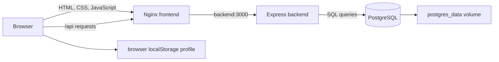

# BINUS Inventory: system theory and implementation

This guide explains the app built during this chat: its architecture, data flow, design choices, and current limits.

## What the app does

BINUS Inventory is a campus inventory app. An operator records an item name, asset code, category, location, quantity, and status, then searches, updates, or removes the record.

The initial project had a browser-based frontend and optional demo data in `localStorage`. The implementation added an Express backend, PostgreSQL persistence, Docker Compose services, and improvements to the dashboard, full inventory view, account menu, and quick guide.

## Client-server architecture

The app has three main parts. The browser is the presentation layer. Node.js and Express make up the application layer. PostgreSQL is the data layer.



In Docker, Nginx serves the page and forwards `/api/` requests to Express. Express queries PostgreSQL. Each service communicates with other containers by its Compose service name, such as `backend` or `db`.

Nginx acts as a reverse proxy: the browser uses one origin for the page and the API, while the backend and database remain inside the Docker network. The browser uses a host port, `8081` in the current local setup. The backend uses container port `3000` and PostgreSQL uses `5432` inside Docker.

## API and CRUD

CRUD describes four operations: create, read, update, and delete. The API exposes them as HTTP endpoints:

- `GET /api/items` reads the inventory and returns a JSON array.
- `POST /api/items` adds an item and returns HTTP `201` with the saved record.
- `PUT /api/items/:id` replaces the editable fields on a record.
- `DELETE /api/items/:id` removes a record and returns HTTP `204`.
- `GET /api/health` checks that the backend can query the inventory table.

The record ID is generated by the database. The frontend submits the six editable fields as JSON. After an API write succeeds, the frontend reloads the inventory so the displayed list and counts reflect saved data.

## The inventory table

PostgreSQL stores one row per inventory entry in `items`. It has a generated integer ID, item name, unique asset code, category, location, quantity, and status.

The schema restricts names and locations to 2–100 characters, codes to the 2–30 character uppercase asset-code format, quantity to an integer from 0 through 100000, categories to the four values shown in the form, and statuses to `available`, `borrowed`, or `maintenance`.

The frontend checks values early to show helpful form messages. The backend repeats those checks because API requests can come from outside the form. PostgreSQL enforces key rules again at the storage boundary. Its unique constraint prevents duplicate asset codes even when two browsers try to add the same code at once. The backend translates that conflict into HTTP `409`.

Database values are passed as query parameters rather than concatenated into SQL. This keeps submitted text and SQL instructions separate.

## What the counts represent

A row represents a type or group of inventory with one quantity and one status. For example, a row with quantity 8 and status `borrowed` counts as one inventory record and one borrowed record. The dashboard total is a count of rows; it is not a sum of physical units.

The app does not identify each physical item separately. It does not yet record a borrower's name, loan dates, partial loans, or return history. Changing a row's status does not adjust its quantity.

## Dashboard and Data Inventaris

The Dashboard shows counts for total rows and rows in each status, then previews five records. The API orders records by descending ID; updates to an existing record do not move it to the top because there is no update timestamp.

Data Inventaris shows all records currently returned by the API. Search checks item names, asset codes, and locations. Category and status filters combine with search. A **Muat ulang** button requests fresh data from the backend.

Filtering currently happens in the browser after the full list has loaded. This is simple for a small inventory. A larger inventory would benefit from server-side search and pagination.

The two views use URL fragments, `#dashboard` and `#inventory`. JavaScript updates the page title, selected navigation item, summary cards, filter controls, and displayed rows when the view changes.

## Account menu and saved profile

The top avatar, sidebar profile, and three-dot button open the same account menu. The menu can open a profile form or a quick guide. Saving a profile updates its name, department, and initials across the page.

Profile display details are stored in the current browser's `localStorage`, separate from inventory stored in PostgreSQL. The profile is for display personalization only: there is no login, verified user account, password, server-side session, or role-based access control.

## Persistence and container setup

A Docker container is a running service created from an image. Containers can be recreated during an update, so the database files are stored in the named `postgres_data` Docker volume. The volume persists through `docker compose down` and ordinary rebuilds. `docker compose down -v` also removes the volume and deletes its data. A persistent volume is not a backup.

Compose starts the backend after PostgreSQL becomes healthy, and starts Nginx after the backend health check succeeds. PostgreSQL's health check asks whether the database accepts connections. The API health check asks whether Express can query the `items` table. Nginx's `/health` endpoint checks the web server itself, not end-to-end database connectivity.

The backend creates the table if it does not exist and does so without clearing data. That startup step is not a schema migration. Future structural changes should use explicit migrations.

The backend uses a PostgreSQL connection pool with a maximum of ten connections per process. Database CRUD writes use parameterized SQL statements. The sample-data command inserts its records inside a transaction: it commits the batch on success and rolls it back if an insert fails. Existing asset codes are skipped, so rerunning the seed command leaves those records unchanged.

## Request errors

The API returns `400` for invalid input, `404` for an unknown endpoint or missing record, `409` for a duplicate asset code, `413` for a request body over 16 KB, and `415` for a write with the wrong content type. Unexpected errors return a generic `500`. The health endpoint returns `503` if the database table cannot be queried.

The frontend shows validation errors in the form, request errors in a toast, and load failures in the inventory area. It does not switch to fake data when the API is unavailable.

## Files that hold the implementation

- [Frontend page](frontend/index.html): layout, navigation, forms, account menu, and dialogs.
- [Frontend behavior](frontend/script.js): API calls, inventory rendering, filters, view switching, and profile storage.
- [Frontend styling](frontend/style.css): colors, responsive layout, cards, dialogs, and button states.
- [Nginx configuration](frontend/nginx.conf): frontend serving and API proxy.
- [API routes](backend/src/app.js): request paths, responses, and error handling.
- [Item validation](backend/src/items.js): backend field checks and normalization.
- [Database connection](backend/src/db.js): PostgreSQL connection pool and initial schema setup.
- [Database schema](backend/sql/schema.sql): table columns, indexes, and constraints.
- [Seed command](backend/src/seed.js): optional sample-data transaction.
- [Docker services](compose.yaml): frontend, backend, database, health checks, and persistent volume.

## Scope and next steps

The current project is a local academic prototype with persistent inventory CRUD. It has no authentication, permissions, audit trail, loan-history records, due dates, individually tracked units, live updates across browsers, automatic database backups, or paginated API. Concurrent updates to the same record have no version check, so the last successful update replaces earlier field values.

A real lending workflow would need additional records for users and loans, rules for available quantities, and a return process. Those changes would extend both the data model and the API.

## Run the local app

Start Docker Desktop, then run from the project folder in PowerShell:

```powershell
cd "C:\Users\HP\project cloud service\binus-inventory"
docker compose up --build -d --wait
```

For the current local `.env` setting, open [http://localhost:8081](http://localhost:8081). See [RUN_LOCALLY.md](RUN_LOCALLY.md) for the start, stop, and troubleshooting steps.

## Verification recorded in this chat

At the backend verification stage, 24 automated tests passed against real PostgreSQL. They covered validation, CRUD, duplicate-code races, database constraints, malformed requests, SQL-like text, missing records, persistence, and database failure responses. The Compose stack was also checked through Nginx, and a saved inventory item remained after the database and backend restarted.

After the UI changes, JavaScript syntax and HTML element references were checked, along with the deployed frontend files, API health, and inventory endpoint. Automated browser interaction and screenshot testing were not completed, so the written checks do not establish visual correctness at every screen size.
