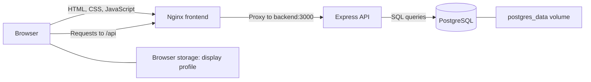

# BINUS Inventory: system theory and implementation

This document explains the application built and updated during this chat: what each part does, how the parts communicate, and why the implementation works this way. It reflects the project files inspected on 20 October 2026.

## 1. What the application does

BINUS Inventory is a local campus inventory application. It lets an operator record an item, assign its category and location, set a quantity and status, and update or delete the record later.

The project started with an HTML, CSS, and JavaScript frontend. Its demo mode kept example items in browser storage. The work in this chat added an Express backend, PostgreSQL storage, Docker Compose configuration, tests, and working navigation and profile controls.

The main responsibilities are:

- **Dashboard:** show inventory totals, status counts, and five recently added records.
- **Data Inventaris:** show the complete inventory with search, category filters, status filters, and editing controls.
- **Account menu:** change the display name and department saved in the current browser, or open the quick guide.
- **Backend:** validate inventory requests and read or write PostgreSQL records.

## 2. Client-server architecture

The application separates presentation, application logic, and persistent data. This is a three-tier design, even when all three tiers run on the same computer.

The **presentation tier** is the browser. HTML provides the page structure, CSS provides the visual style, and JavaScript handles navigation, forms, filtering, and requests.

The **application tier** is the Node.js process running Express. It receives HTTP requests, checks their contents, runs database queries, and returns JSON responses.

The **data tier** is PostgreSQL. It stores the inventory and enforces rules such as unique asset codes and valid quantities.

In the Docker setup, Nginx is the entry point for the browser:



The browser communicates with the API through HTTP. Database credentials and SQL execution remain on the server side.

## 3. Why Nginx acts as a reverse proxy

A reverse proxy receives a request and forwards it to another service. Here, Nginx serves the frontend files itself and forwards paths beginning with `/api/` to Express.

For example, the browser requests:

```text
http://localhost:8081/api/items
```

Nginx forwards that request inside the Docker network to:

```text
http://backend:3000/api/items
```

This gives the browser one origin for both the page and its API. An origin includes the protocol, host, and port. Because the frontend uses relative `/api` URLs, it does not need a separate browser-side CORS configuration for this setup.

`backend` and `db` are Docker service names. Containers use them to find each other. The browser uses the published localhost address instead.

The proxy configuration is in [frontend/nginx.conf](frontend/nginx.conf).

## 4. REST-style API and CRUD

CRUD stands for Create, Read, Update, and Delete. The API represents inventory records as resources under `/api/items` and uses HTTP methods to select an operation.

- `GET /api/items` reads all records and returns a JSON array.
- `POST /api/items` creates a record and returns the saved item with HTTP `201`.
- `PUT /api/items/:id` replaces the six editable fields of an existing record and returns the updated item.
- `DELETE /api/items/:id` removes a record and returns HTTP `204` with no response body.
- `GET /api/health` checks whether the backend can access the inventory table.

The `:id` part identifies one database record. PUT expects the complete set of editable fields; the application does not implement partial PATCH updates.

A typical item response is:

```json
{
  "id": 1,
  "name": "Proyektor Epson",
  "code": "BIN-ELE-001",
  "category": "Elektronik",
  "location": "Ruang Kelas 402",
  "quantity": 8,
  "status": "available"
}
```

The database generates `id`. The browser submits the other six fields as JSON. The routes are implemented in [backend/src/app.js](backend/src/app.js).

## 5. What happens when an item is saved

The save operation follows this sequence:

1. The operator enters the item details and submits the form.
2. Frontend validation checks the values and shows any field errors.
3. JavaScript sends a POST request for a new item or a PUT request for an existing item.
4. Express parses the JSON body and validates the values again.
5. The backend sends a parameterized INSERT or UPDATE query to PostgreSQL.
6. PostgreSQL checks the table constraints and saves the change if it is valid.
7. Express returns the saved record as JSON.
8. The frontend requests the inventory again and redraws the table and summary counts.

Reloading the list after a successful write makes the displayed inventory reflect the server response. The frontend does not assume a browser-only edit has already been saved in the database.

Other open browsers are not automatically notified. They receive current data when they reload the page or use **Muat ulang** in Data Inventaris.

## 6. Relational database design

PostgreSQL stores records in the `items` table. Each row has the same defined set of columns and rules.

- **`id`:** a generated integer primary key. It identifies the row even if its asset code changes.
- **`name`:** the item name, limited to 100 characters.
- **`code`:** a unique asset code, limited to 30 characters.
- **`category`:** one of the four categories used by the frontend.
- **`location`:** the item location, limited to 100 characters.
- **`quantity`:** an integer from 0 to 100000.
- **`status`:** `available`, `borrowed`, or `maintenance`.

All seven columns are required. Database CHECK constraints restrict the allowed values, and a UNIQUE constraint prevents two rows from sharing an asset code.

The database also requires asset codes to match the uppercase code format. The backend trims and uppercases submitted codes before writing them, so `bin-ele-001` and `BIN-ELE-001` become the same code.

The schema is defined in [backend/sql/schema.sql](backend/sql/schema.sql).

### A record represents a group of items

The current model stores a quantity and one status for each record. For example, a projector record with quantity 8 and status `borrowed` describes that whole inventory entry.

The system does not track eight individually identified projectors, separate borrowers, due dates, or partial loans. Changing the status does not automatically change the quantity.

### What the dashboard counts mean

Dashboard numbers count **records**, not physical units. One record with quantity 8 contributes:

- 1 to the total number of item types;
- 1 to its status category;
- no additional records for its remaining seven units.

This matches the label **Total jenis barang**. The dashboard does not calculate the sum of all quantity values.

## 7. Validation at three boundaries

Validation is repeated because each layer has a different responsibility.

**Frontend validation** gives immediate feedback. It checks required fields, code format, allowed category and status, integer quantity, and duplicate codes in the currently loaded list. HTML also limits the lengths of the name, location, and code inputs.

**Backend validation** protects the API when a request bypasses the form. It requires valid field types and lengths, trims names and locations, normalizes codes, and accepts quantity only as a JSON integer in the permitted range. A numeric string such as `"8"` is rejected by the backend.

**Database constraints** protect the stored data. They continue to apply when another database client writes directly to the table.

The backend rules are in [backend/src/items.js](backend/src/items.js).

### Why a database uniqueness rule is necessary

Two browsers can both check an asset code before either saves it. Both browser checks could pass because neither browser has seen the other's new record.

The database UNIQUE constraint resolves that race at the point of writing. One insert succeeds, and the competing insert fails. The backend translates PostgreSQL duplicate-key error `23505` into HTTP `409` with a readable message.

## 8. Parameterized queries and safe rendering

The backend passes SQL instructions and submitted values separately:

```js
await pool.query('DELETE FROM items WHERE id = $1', [id]);
```

`$1` is a placeholder. The submitted ID is treated as a value rather than being pasted into the SQL command. The same approach is used for inserts and updates.

On the frontend, inventory values are escaped before being inserted into HTML strings. Profile names and departments are assigned with `textContent`. These choices prevent those display paths from interpreting submitted text as HTML markup.

The JSON request-body limit is 16 KB. Unexpected server errors are logged on the backend while the client receives a generic error message.

## 9. Database connections and transactions

The backend uses the `pg` library's connection pool. A pool reuses database connections across requests instead of opening a new connection for every operation.

The current configuration allows up to 10 connections per backend process. It also sets a 5-second connection timeout, a 30-second idle timeout, and a 10-second statement timeout. These are configuration limits, not guarantees about request response time.

Each CRUD write uses one SQL statement. Sample-data insertion uses an explicit transaction because it performs several inserts as one batch:

```text
BEGIN -> insert sample records -> COMMIT
                            failure -> ROLLBACK
```

This prevents a failed seed run from leaving only part of that batch committed. Connection setup is in [backend/src/db.js](backend/src/db.js), and seeding is in [backend/src/seed.js](backend/src/seed.js).

## 10. Persistence and Docker volumes

A container is a running instance of an image. Rebuilding an image replaces application files; it should not replace the inventory database.

Compose mounts the named `postgres_data` volume at PostgreSQL's data directory. The database therefore survives container restarts, application rebuilds, and ordinary `docker compose down` followed by `docker compose up`.

`docker compose down -v` also removes the Compose-managed named volume and deletes that database data. A Docker volume provides persistence; it is not a separate backup.

Browser storage has a different role:

- Inventory is stored in PostgreSQL during normal operation.
- The display profile is stored in browser `localStorage` under `binus-inventory-profile-v1`.
- Optional demo inventory uses a separate browser-storage key and is enabled only when `DEMO_MODE` is changed to `true`.

The normal frontend setting is `DEMO_MODE = false`. It does not silently switch to demo inventory when the API fails.

## 11. Docker Compose and local networking

[compose.yaml](compose.yaml) defines three services: `frontend`, `backend`, and `db`.

- The frontend container runs Nginx on internal port 8080.
- The backend container runs Node.js on internal port 3000.
- PostgreSQL uses internal port 5432.

The frontend is published to localhost using `WEB_PORT`. The local configuration used in this chat selected 8081 because port 8080 was already occupied. The Compose default is 8080 when `WEB_PORT` is not set.

The normal stack does not publish the backend or database directly to the host. [compose.dev.yaml](compose.dev.yaml) can publish PostgreSQL to `127.0.0.1:5432` when running Node.js outside Docker.

Environment variables supply configuration such as the database host, user, password, and database name. `.env.example` supplies example settings; `.env` holds local settings and is ignored by Git.

The backend image installs its dependencies with `npm ci` using the lockfile. Both application containers are configured to run as non-root users. The PostgreSQL container uses its image's own startup behavior.

### Running Node.js directly

The Express application can also serve the three frontend files itself. In that mode, the browser opens port 3000 and uses the same origin for frontend and API requests. PostgreSQL is still required, but Nginx is not part of that request path.

## 12. Startup, readiness, and shutdown

The backend initializes the table before it starts accepting HTTP requests. `CREATE TABLE IF NOT EXISTS` allows repeated startup without clearing existing inventory.

This initialization does not migrate an existing table to a changed schema. Future structural changes need explicit database migrations.

Compose starts the backend after the database health check passes, then starts the frontend after the backend health check passes. This reduces failures caused by starting a dependent service too early.

The health checks answer different questions:

- PostgreSQL's check asks whether the database server is accepting connections.
- `/api/health` asks whether the backend can query the `items` table. It returns `200` on success and `503` on failure.
- Nginx's `/health` confirms that the frontend server responds. It does not independently prove that the API or database works.

Dependency checks control startup. They do not guarantee that every service stays available afterward. The restart policy restarts exited containers; an unhealthy status alone does not trigger a container restart.

On shutdown, the backend stops accepting new requests, closes idle HTTP connections, and ends the database pool. A timeout prevents shutdown from waiting indefinitely. This behavior is in [backend/src/server.js](backend/src/server.js).

## 13. Dashboard and Data Inventaris

The two navigation links now represent different views within one frontend page.

**Dashboard** displays status cards and a preview of five records. The API sorts by descending ID, so the preview takes the five highest IDs. Editing an existing item does not move it to the top. There is no update-time field used for ordering.

**Data Inventaris** displays all loaded records, search, category and status filters, and a reload button. Search checks the name, asset code, and location without case sensitivity. Category and status filters are combined with the search condition.

Filtering happens in the browser after the API returns the complete inventory. No database query runs for each keystroke. This keeps the current implementation simple, although large inventories would benefit from server-side filtering and pagination.

Navigation uses URL fragments, `#dashboard` and `#inventory`. JavaScript listens for changes, updates the selected navigation link and breadcrumb, and shows the relevant controls. Both views use the same underlying inventory array.

## 14. Account UI and interaction design

The sidebar profile, three-dot button, and top avatar open the same account menu. It provides access to the profile form and quick guide.

Saving a display profile updates the visible name, department, and avatar initials together. It persists in the same browser storage context across page reloads. Opening the application in another browser or on a different origin can show a different profile.

This feature provides display personalization. The application currently has no user registration, password verification, authenticated session, account database, or role-based permissions. Editing the display profile does not grant or restrict inventory access.

The UI additions include Escape dismissal, focus restoration for account dialogs, Tab wrapping inside dialogs, descriptive button labels, and expanded-state attributes for account-menu triggers.

The existing navy sidebar, blue primary buttons, rounded cards, spacing, and typography were retained. The logo's `+` was positioned within its badge to fix the earlier grid placement issue. The visible API connection badge was removed while API requests, error states, and health checks remain implemented.

## 15. Error handling

The API returns HTTP status codes that describe the result:

- **400:** invalid item input, malformed JSON, or an invalid record ID.
- **404:** a missing record or unknown endpoint.
- **409:** an asset code already exists.
- **413:** the request body exceeds the configured limit.
- **415:** a write request uses an unsupported content type.
- **500:** an unexpected server-side error during an ordinary request.
- **503:** the API health check cannot access the database table.

Validation errors include a message and field-level errors where applicable. The frontend displays useful messages through form errors, table error states, or toast notifications.

When inventory loading fails, the frontend keeps an error state rather than replacing it with invented sample data. An API health check is an operational diagnostic, even though its status no longer appears in the page header.

## 16. Sample data and repeatable setup

The optional seed command adds seven example inventory records. Each insert uses `ON CONFLICT (code) DO NOTHING`, so rerunning the seed skips codes already present and preserves their existing values.

Seeding runs only when requested. Restarting the app does not automatically restore deleted sample records. Running the seed explicitly can add a previously deleted sample again, because its code is available.

Application startup and sample-data setup are separate responsibilities: startup prepares the table, while the seed command supplies demonstration content.

## 17. Verification performed during this chat

At the backend verification stage, **24 automated tests passed** against real PostgreSQL. They covered input validation, CRUD, persistence across database connections, duplicate-code races, duplicate updates, invalid and missing IDs, malformed requests, SQL-like text, database constraints, and database-failure responses.

Integration tests use a randomly named schema and remove that schema afterward. They run only when `TEST_DATABASE_URL` is supplied; ordinary test execution without it skips the PostgreSQL suite. A separate test database keeps those checks away from the real inventory.

Additional checks in this chat verified CRUD through Nginx and confirmed a saved item survived a PostgreSQL/backend restart. Seeding inserted seven records on its first test run and zero additional records on the second.

After the UI changes, JavaScript syntax, element references, unique HTML IDs, removal of the API label, deployed frontend-file contents, API health, and the inventory endpoint were checked successfully.

Browser interaction and visual regression tests were not completed at that stage: browser tooling could not initialize, and a fallback installation encountered a full disk. The backend tests do not establish that every UI interaction or screen size has been tested. This documentation task does not claim a new test run.

Test sources are [backend/test/items.test.js](backend/test/items.test.js) and [backend/test/api.test.js](backend/test/api.test.js).

## 18. Current scope and practical limits

The current design supports a small local academic prototype. It has persistent inventory CRUD and a browser-side interface, with several clear boundaries:

- There is no authentication or authorization layer.
- Borrower identities, loan history, due dates, and individual-unit tracking are not modeled.
- Inventory records have no audit history or created/updated timestamps.
- Concurrent edits have no version check; a later successful update can replace an earlier update.
- Open clients do not receive live updates.
- The API returns the full inventory without pagination.
- Database backups, managed schema migrations, and public HTTPS hosting are outside the implemented setup.

These boundaries explain which changes would require additional data structures or backend behavior. A real borrowing workflow, for example, would need loan records connected to inventory and borrowers, along with rules for available quantities and return events.

## 19. Run the current local setup

Start Docker Desktop with Linux containers, then run in PowerShell:

```powershell
cd "C:\Users\HP\project cloud service\binus-inventory"
docker compose up --build -d --wait
```

With `WEB_PORT=8081` in the project's `.env`, open http://localhost:8081.

Optional sample data and an API check:

```powershell
docker compose exec backend npm run seed
Invoke-RestMethod http://localhost:8081/api/health
```

Stop the stack while keeping its database volume:

```powershell
docker compose down
```

## 20. Where to read the implementation

- [frontend/index.html](frontend/index.html): page structure, forms, navigation, and account dialogs.
- [frontend/style.css](frontend/style.css): shared visual styling, logo alignment, and responsive rules.
- [frontend/script.js](frontend/script.js): browser state, API calls, rendering, navigation, filtering, and profile storage.
- [frontend/nginx.conf](frontend/nginx.conf): static-file serving and reverse proxy.
- [backend/src/app.js](backend/src/app.js): HTTP routes, responses, and error handling.
- [backend/src/items.js](backend/src/items.js): inventory input validation.
- [backend/src/db.js](backend/src/db.js): PostgreSQL pool and initial schema setup.
- [backend/src/server.js](backend/src/server.js): application startup and shutdown.
- [backend/sql/schema.sql](backend/sql/schema.sql): inventory table and database constraints.
- [backend/src/seed.js](backend/src/seed.js): optional sample-data transaction.
- [compose.yaml](compose.yaml): service definitions, health checks, port mapping, and database volume.
